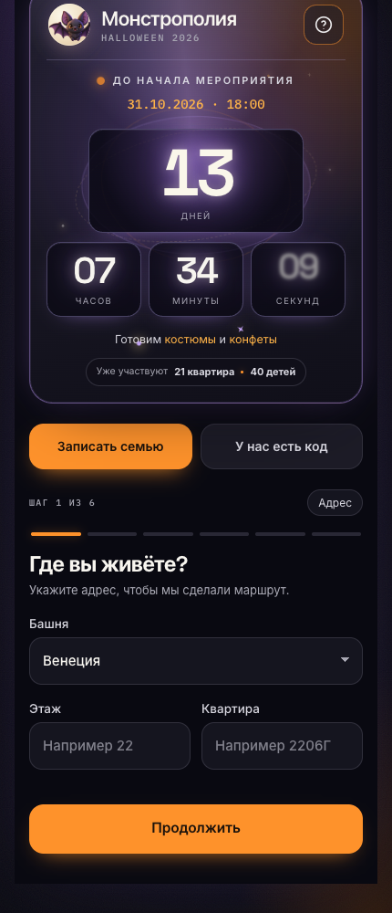
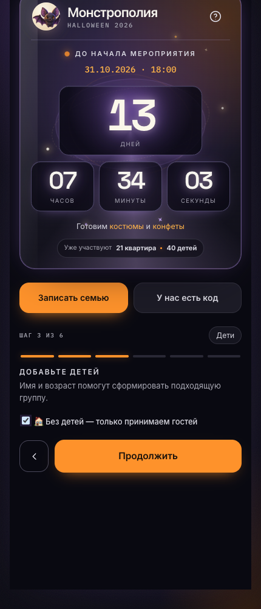
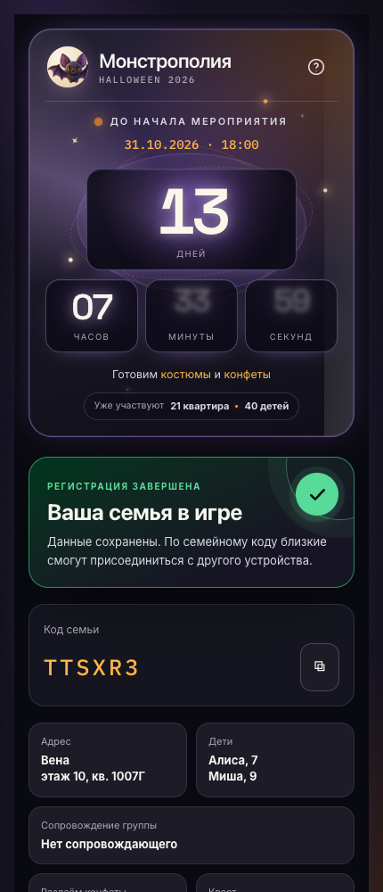
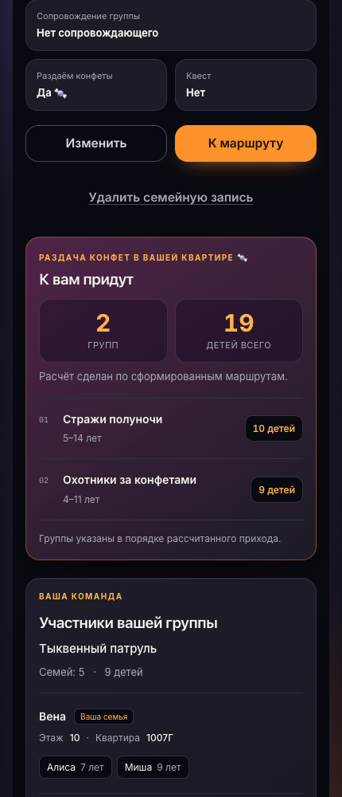
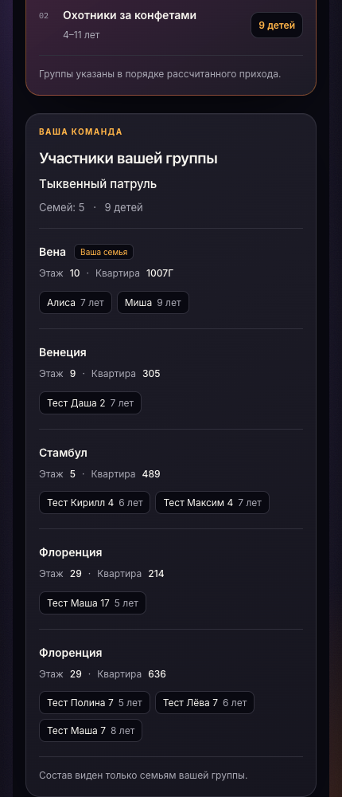
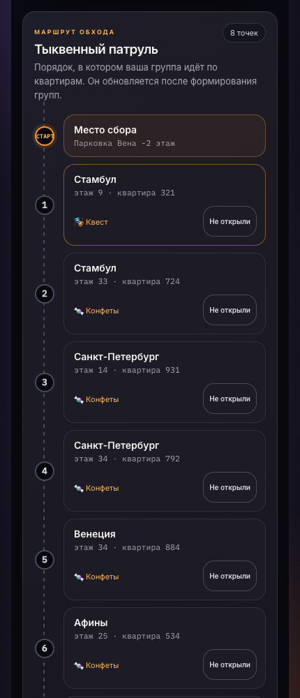
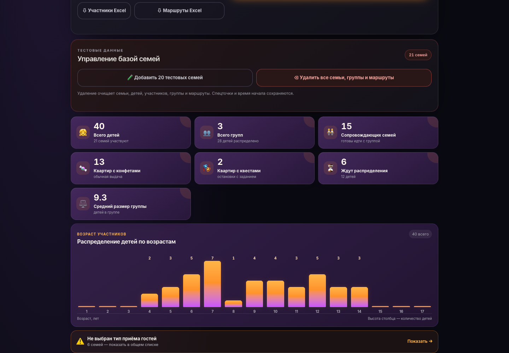

# 🎃 Монстрополия — Halloween-бот и мини-приложение

Приложение для организации обхода квартир детьми на Halloween в жилом комплексе. Работает в Telegram и MAX: семьи записываются, организатор формирует группы и маршруты, принимающие квартиры видят ожидаемые посещения. Отдельно доступны игры для праздничных площадок.

Документ описывает реализацию в этом репозитории. Настройки и данные рабочего сервера могут отличаться от локальных. Обновление репозитория на GitHub само по себе не обновляет сервер.

## Скриншоты

Снимки сделаны на локальной версии с отдельной тестовой базой. Все имена, семейные коды, квартиры и составы групп в этой галерее — демонстрационные, не данные участников мероприятия.

| Главная и запись | Принимающая квартира без детей |
|---|---|
|  |  |

| Карточка семьи | Ожидаемые группы |
|---|---|
|  |  |

### Участники своей группы



Персональный состав виден только семьям своей группы. Принимающие квартиры видят у приходящих групп название, возрастной диапазон и количество детей, без персонального списка посетителей.

### Маршрут группы



### Административная сводка



## Содержание

- [Возможности участников](#возможности-участников)
- [Регистрация и доступ](#регистрация-и-доступ)
- [Формирование групп](#формирование-групп)
- [Построение маршрутов](#построение-маршрутов)
- [Уведомления](#уведомления)
- [Административная панель](#административная-панель)
- [Игры](#игры)
- [Установка и конфигурация](#установка-и-конфигурация)
- [Обновление и резервное копирование](#обновление-и-резервное-копирование)
- [Устройство проекта и API](#устройство-проекта-и-api)
- [Ограничения реализации](#ограничения-реализации)

## Возможности участников

- Регистрация квартиры с детьми или квартиры, которая только принимает гостей.
- Указание башни, этажа и номера квартиры отдельными полями.
- Добавление нескольких детей с именами и возрастами.
- Пожелание ходить вместе с другой зарегистрированной семьёй.
- Отметки о сопровождении группы взрослым, раздаче конфет и проведении квеста.
- Вход в существующую семейную запись по коду, в том числе из другого мессенджера.
- Копирование и передача кода семьи, редактирование и полное удаление записи.
- Просмотр группы, места сбора и полного маршрута с башнями, этажами и квартирами.
- Различение квестов и обычных точек раздачи конфет.
- Отметки «Открыли» / «Не открыли» на маршруте.
- Для принимающих квартир — количество ожидаемых групп и детей, список названий групп и возрастов детей в порядке рассчитанного прихода.
- Обратный отсчёт до мероприятия, его дата и время, общий счётчик квартир и детей, руководство по приложению.

## Регистрация и доступ

### Шесть шагов

| Шаг | Что указывается |
|---|---|
| 1. Адрес | Башня из списка, этаж, номер квартиры; ранняя проверка дубликата |
| 2. Совместная группа | По желанию — поиск зарегистрированной семьи по башне и квартире |
| 3. Дети | Имя и возраст каждого ребёнка либо «Без детей — только принимаем гостей» |
| 4. Сопровождение | Готов ли взрослый сопровождать детскую группу |
| 5. Участие | Раздача конфет и/или квест; длительность квеста |
| 6. Проверка | Подтверждение введённых данных и создание семейной записи |

Детям задаётся целочисленный возраст от 1 до 17 лет. Этаж проверяется отдельно: целое число от 0 до 200 в пользовательской форме и API. Номер квартиры должен содержать цифры; буквы в номере допускаются.

### Квартиры без детей

На третьем шаге можно выбрать «🏠 Без детей — только принимаем гостей». Детские поля скрываются, пожелание совместной группы очищается, сопровождение отключается; шаг сопровождения пропускается. Нужно выбрать раздачу конфет или квест. В базе такая запись хранится как обычная семья без строк в таблице детей, с выключенным участием в обходе.

Такая квартира:

- получает код семьи и доступ к редактированию;
- включается в пул принимающих адресов;
- не занимает места в детской группе;
- видит прогноз посещений и список приходящих групп.

Режим доступен и при редактировании записи. Сервер не разрешает запись без детей с включённым обходом/сопровождением или без приёма гостей.

### Защита от дубликатов

Активные квартиры сравниваются по башне, этажу и цифрам номера квартиры. Регистр и внешние пробелы в названии башни не учитываются; номер нормализуется и сравнивается без букв и прочих нецифровых символов. Например, `1007` и `1007Г` на одном этаже одной башни считаются одной квартирой.

На другом этаже или в другой башне одинаковый номер допустим. Отменённые записи не препятствуют регистрации. При редактировании текущая запись исключается из поиска конфликта.

Если квартира уже зарегистрирована, нужно получить код у родных и присоединиться к существующей записи. Проверка повторяется на сервере при сохранении, а не только в форме.

### Код семьи и несколько аккаунтов

Код даёт доступ к общей семейной записи. Его можно использовать второму взрослому или при переходе из Telegram в MAX. Один аккаунт привязывается к одной семье. Привязанные пользователи работают с общими данными, а не с независимыми копиями. Код следует передавать только тем, кому нужен доступ к семье.

### Закрытие регистрации

В админке есть переключатель «Закрыть регистрацию новых семей». Состояние сохраняется в базе и действует после перезапуска.

При закрытии:

- форма создания семьи заменяется сообщением «К сожалению, регистрация окончена. Добавление новых участников невозможно»;
- кнопка записи становится недоступной;
- остаётся вход по коду существующей семьи;
- сервер блокирует создание новой семьи, даже если форму открыли до закрытия.

Переключатель блокирует именно создание новых семей. Он не запрещает вход по коду, редактирование существующих записей или работу организатора с тестовыми данными. Отдельного запрета на добавление детей при редактировании существующей семьи сейчас нет.

## Формирование групп

### Кто допускается

Для автоматического формирования семья должна:

1. Участвовать в обходе.
2. Не быть отменённой.
3. Не находиться на паузе автоматического подбора.
4. Раздавать конфеты, проводить квест **или** иметь установленную администратором отметку «Принесли конфеты».

Семьи без приёма гостей и без отметки о принесённых конфетах остаются вне распределения. Отметка ставится вручную и сохраняется администратором. Она даёт допуск к группе, но не превращает квартиру в остановку маршрута. Условие допуска проверяется и при ручном назначении семьи в существующую группу.

### Приоритеты и размер

Ручное закрепление за группой учитывается отдельно. Для остальных семей пожелания «ходим вместе» объединяются в неделимые связки: если А хочет с Б, а Б с В, связка включает всех троих. Дети одной семьи также не разделяются.

Затем алгоритм подбирает группы с учётом размера, близости возрастов и башни. Это оптимизация с весами, а не последовательность абсолютных запретов: после сохранения неделимых связок отклонения по размеру штрафуются сильнее возрастных различий, а возрастные различия — сильнее смешения башен.

Ориентир — 5–8 **детей**, не семей и не взрослых. Возрастной ориентир «±4 года» реализован как желаемая разница между самым младшим и самым старшим не более 8 лет. Это не жёсткое ограничение: пожелания, ручные назначения и доступные составы могут привести к более широкому диапазону.

### Остаток при первичном формировании

- До 8 детей всего — одна группа, в том числе если детей меньше пяти.
- Группы ориентировочно набираются восьмёрками.
- Остаток больше четырёх детей образует следующую группу.
- Остаток от одного до четырёх детей распределяется в уже создаваемые группы, с разрешением превышать восемь.

Примеры для детей, которых можно свободно распределить:

| Всего детей | Целевые размеры |
|---|---|
| 8 | 8 |
| 12 | 12 |
| 16 | 8 + 8 |
| 19 | 10 + 9 |
| 21 | 8 + 8 + 5 |

Неделимые семьи и связанные пожелания могут изменить фактический размер. Связка не разрезается ради соблюдения числа восемь.

### «Распределить ожидающих»

Эта кнопка дополняет существующие группы, сохраняя их участников и названия. Число на кнопке показывает количество допущенных ожидающих **семей**.

1. Начальная ожидающая семья выбирается случайно при каждом запуске.
2. Связанные пожеланиями ожидающие семьи обрабатываются вместе.
3. При наличии пожелания к участнику существующей группы предпочтение получает эта группа, даже если придётся превысить восемь детей.
4. В остальных случаях сначала используются места до восьми детей, с учётом возраста и башни.
5. Если после заполнения осталось больше четырёх детей, создаются дополнительные группы.
6. Хвост до четырёх детей добавляется преимущественно в меньшие группы сверх обычного лимита.
7. Маршруты перестраиваются для всех групп, поскольку нагрузка на адреса общая.

Если групп ещё нет, сначала используется полное формирование. В отличие от обычного полного подбора, явное распределение ожидающих может забрать семьи, ранее поставленные на паузу, если они соответствуют условиям допуска.

### Полное формирование и удаление групп

«Сформировать группы и маршруты» пересоздаёт составы и маршруты по текущим данным. Ручные закрепления учитываются; прежние названия и места сбора сохраняются по совпадающему ID группы, а не по неизменности её состава.

При удалении группы её семейные записи сохраняются, а участники переходят в ожидание с паузой автоподбора. При удалении семьи только из группы её регистрация также сохраняется. Администратор может назначить её вручную, вернуть в автоподбор или явно распределить ожидающих.

Если удалены все группы, полное формирование снимает паузу с активных участников обхода, чтобы группы можно было создать снова. Проверка конфет/квеста/принесённых конфет при этом сохраняется.

### Названия групп

В базе есть редактируемый каталог из 30 исходных Halloween-названий: по десять для диапазонов 1–6, 7–10 и 11–17 лет. Администратор может задавать собственные названия и диапазоны 1–17 лет.

Новой группе выбирается свободное название, наиболее близкое к её **среднему** возрасту. Если подходящие варианты заняты, используются ближайшие диапазоны; при исчерпании каталога добавляется числовой суффикс. При пустом каталоге используется «Хэллоуинская команда». Автоматическое назначение избегает повторов среди обрабатываемых групп.

Существующие названия сохраняются. Редактирование или удаление элемента каталога не переименовывает уже созданные группы. Исходные названия добавляются одноразовыми миграциями: удалённые администратором элементы не восстанавливаются при каждом запуске. Ручное переименование группы — отдельная операция.

## Построение маршрутов

### Источники остановок

- Неотменённые квартиры с раздачей конфет или квестом, включая квартиры без детей.
- Активные спецточки: магазины, общие площадки и другие места, заведённые организатором.

Участие хозяев в обходе не обязательно. Квартира только с отметкой «Принесли конфеты» в этот список не входит.

### Количество и состав

Текущий целевой размер — **до 8 остановок на группу**. В коде также есть технический потолок 10, но текущий набор остановок до него не доходит. Если доступно меньше восьми адресов, маршрут короче. Если нет принимающих точек — маршрут пуст.

Одна точка не повторяется внутри маршрута. Соотношение квестов и обычной раздачи выбирается примерно пропорционально их количеству среди доступных адресов. Если есть оба типа и минимум две остановки, алгоритм стремится включить хотя бы по одной каждого типа. Одинаковое число квестов у всех групп не является абсолютной гарантией.

### Башни, этажи и нагрузка

Сначала адреса собираются блоками по 2–3 в одной башне. При наличии выбора следующий блок предпочтительно берётся из другой башни. Учитываются башни участников, уже использованная нагрузка на башни и квартиры, нужный баланс квестов и конфет. Внутри выбранного блока адреса упорядочиваются по этажам снизу вверх.

Это эвристика, а не поиск кратчайшего пути по карте: реальная длина коридоров, лифты, расстояния между башнями и время ожидания лифтов не моделируются.

Квартиры участников самой группы исключаются, если внешних адресов хватает на целевой маршрут. При нехватке внешних точек собственные квартиры также допускаются. Поэтому единственная принимающая семья может получить маршрут на свою квартиру.

### Разведение одинаковых этапов

После выбора адресов алгоритм меняет порядок остановок, стараясь исключить одну квартиру на одном номере этапа у разных групп. Например, квартира не должна одновременно быть третьим этапом у двух групп.

Если подходящий порядок не найден, используется циклический сдвиг с минимальным количеством совпадений. Это попытка уменьшить конфликты, а не гарантия отсутствия всех конфликтов для любого набора данных. Финальная перестановка может нарушить исходные блоки по башням и порядок этажей.

### Расчёт времени

| Действие | Длительность |
|---|---|
| Обычная раздача конфет | 7 минут |
| Переход между любыми двумя точками | 5 минут |
| Квест | Указанная длительность, по умолчанию 20 минут |
| Запас между группами в одной квестовой точке | 5 минут |

Время хранится в минутах от условного начала маршрута. Для квестовых точек рассчитываются последовательные интервалы, а ожидание может сдвигать последующие остановки. Это плановый расчёт, не отслеживание фактического движения и не полноценная система бронирования: после сдвигов и ручных изменений требуется проверка организатором.

Для обычных квартир нет отдельного строгого запрета на пересечение по времени. Разные номера этапов не гарантируют разное фактическое время прихода.

### Ручная корректировка

В админке можно менять название и место сбора группы, состав и порядок маршрута. Остановки перетаскиваются внутри группы или перемещаются стрелками.

Сервер принимает только перестановку всех текущих остановок ровно по одному разу и блокирует сохранение, если новая позиция совпадает с той же точкой на таком же этапе другой группы. Ручная перестановка обновляет номера этапов, но **не пересчитывает сохранённое время прибытия и убытия**.

### Что видят хозяева

Принимающая квартира видит число посещающих групп, суммарное число детей и список групп с диапазоном от минимального до максимального возраста. Список отсортирован по сохранённому плановому времени прибытия; само время в нём не показывается. После ручной перестановки порядок списка может отражать старые расчётные времена.

### Полное удаление семьи

Удаляются её дети, привязки аккаунтов и связанные записи; её квартира убирается из маршрутов.

- До начала мероприятия маршруты остальных групп перестраиваются, составы сохраняются, размеры пересчитываются.
- После начала сохраняется порядок оставшихся остановок, этапы и время уплотняются.
- Опустевшие группы удаляются. Группы меньше пяти детей отмечаются как требующие внимания в результате операции.

Само редактирование анкеты не равнозначно полному пересчёту. После смены типа участия, отмены, изменения состава детей и других существенных правок организатору следует проверить существующие группы и маршруты.

## Уведомления

### Приветствие

Telegram реагирует на `/start`; MAX — на запуск бота и поддерживаемую команду start. Пользователь получает приветствие и инструкцию открытия мини-приложения. В MAX предусмотрена резервная отправка текста, если сообщение с кнопкой не принято API.

### Группа сформирована или изменена

> 🎃 Ваша группа «Название» сформирована. Маршрут уже доступен в мини-приложении.

Сообщение с кнопкой маршрута отправляется привязанным Telegram/MAX-аккаунтам семей группы. Рассылка вызывается при формировании, распределении ожидающих и ряде административных изменений состава, названия, места сбора и маршрута, а также при удалении семьи с восстановлением маршрутов.

- Сравнивается подпись состава, названия, места сбора и остановок.
- При неизменной подписи повтор не отправляется.
- Для каждого аккаунта действует интервал не менее пяти минут между успешными уведомлениями этого типа.
- Изменения внутри интервала пропускаются; отложенной очереди и автоматической отправки по истечении пяти минут нет.
- Текст при обновлении остаётся «группа сформирована».
- Удалённая из группы семья не получает отдельного сообщения об исключении через эту рассылку; уведомляются оставшиеся участники изменившихся групп.

### Конфеты приняты

> 🎃 Конфеты приняты! Сладкий взнос в фонд маленьких монстров засчитан 🍬👻
>
> Спасибо! Теперь ваша семья допущена к распределению по группам. Когда группа будет сформирована, мы пришлём отдельное сообщение 🦇

Отправляется привязанным аккаунтам семьи при сохранении перехода отметки «Принесли конфеты» из выключенного состояния во включённое. Повторное сохранение включённой отметки не рассылает сообщение. Если снять, сохранить и установить заново — отправка повторится. Пятиминутное ограничение групповой рассылки на это сообщение не распространяется. Ошибки отправки показываются в результате сохранения; автоматического повторения доставки нет.

### Новая семья после распределения

Администратор получает Telegram-сообщение с башней, этажом, квартирой, детьми, типом приёма гостей и участием в обходе, а также кнопкой «Открыть админку».

Условие отправки — успешное создание новой семейной записи, когда в базе уже есть хотя бы одна остановка маршрута. Это проверка текущего наличия маршрутов, а не исторического факта нажатия кнопки формирования. Вход родственника по коду не является новой семьёй и не вызывает это сообщение.

Получатель определяется по `SUPER_ADMIN_TELEGRAM_ID`; если он не задан — по сохранённой Telegram-привязке с `SUPER_ADMIN_TELEGRAM_USERNAME`. Для надёжной доставки нужно задать ID, а администратор должен начать диалог с ботом. Ошибка уведомления не отменяет регистрацию.

### Чего пока нет

Нет автоматических напоминаний о начале праздника, приближении группы, необходимости принести конфеты, отдельной рассылки о закрытии регистрации или гарантированной очереди повторной доставки. Присоединение по коду не запускает немедленную отправку ранее пропущенных сообщений.

## Административная панель

Адрес — `/admin.html`. Доступ возможен по паролю `ADMIN_PASSWORD` или из Telegram под суперпользователем с валидными данными инициализации. Имя/ID суперпользователя задаются в окружении. Наличие кнопки на экране не заменяет серверную проверку прав.

### Сводка и настройки

- Количество участвующих в обходе детей и семей, групп, принимающих квартир с конфетами и квестами.
- Число ожидающих, средний размер групп, распределение возрастов.
- Ссылка из виджета незаполненного типа приёма гостей на фильтр списка семей.
- Настройка начала мероприятия и закрытия новых регистраций.
- Полное формирование групп и маршрутов, распределение ожидающих.

Счётчик на главной и сводка админки имеют разный смысл: главный счётчик считает все неотменённые записи и детей, а часть метрик админки — только участвующих в обходе. Квартира без детей увеличивает число квартир, но не число детей.

### Семьи и фильтры

Администратор видит адреса, код семьи, детей, привязанные аккаунты, тип участия и группу; может редактировать данные, ставить отметку о конфетах, задавать ручную группу и удалять семью.

Фильтры скрыты под кнопкой и комбинируются: текстовый поиск, башня, возраст ребёнка, участие/отмена, наличие группы, сопровождение, приём гостей, принесённые конфеты, квартиры без детей. Между разными категориями действует «И», внутри альтернатив одной категории — «ИЛИ». Показывается количество найденных семей.

Фильтры «Принесли конфеты» / «Не принесли конфеты» относятся к неотменённым семьям без квеста и раздачи. Квартиры без детей видны без возрастного ограничения; при заданном возрасте фильтр требует подходящего ребёнка и исключает такие квартиры.

### Каталог, спецточки и экспорт

- Каталог названий групп: добавление, редактирование, удаление и возрастные диапазоны.
- Спецточки: название, башня, этаж, активность и параметры квеста.
- Экспорт участников в `.xlsx`: одна строка на ребёнка, адрес, код семьи, группа и статусы. Квартиры без детей в этот детский экспорт не попадают; отменённые записи представлены со статусом.
- Экспорт маршрутов в `.xlsx`: одна строка на остановку, группа, число/состав детей, адрес, тип точки и расчётное время. Пустой маршрут представлен отдельной строкой.

### Тестовый блок

Кнопка добавления создаёт 20 случайных **семей**, в каждой может быть несколько детей. Есть единая кнопка удаления всех семей, детей, привязок участников, групп и маршрутов. Она удаляет реальные записи наравне с тестовыми, если нажата в рабочей базе. Настройки события, каталог названий и спецточки сохраняются.

## Игры

Каталог открывается отдельно по `/games`; ссылки на него на главной регистрации нет. Игры рассчитаны на большой экран/телевизор и управление указателем.

- **Мегатонна** — `/games/bomb`: командное обезвреживание бомбы, досье, ограниченное время, штрафы и серия раундов. Состояние и проверка действий на сервере. Подробные правила — [docs/megatonna.md](docs/megatonna.md).
- **Проверка пропусков** — `/games/pass`: проверка посетителей по документам, срокам, личности, радиации и багажу; сценарии и смены реализованы в браузере.
- **Радтараканы** — `/games/roach`: защита печенья от приближающихся тараканов, таймер, лазер, музыка и звуковые настройки.

Игровые раунды не распределяют семьи и не меняют маршруты. Состояние Мегатонны хранится в памяти процесса и теряется при перезапуске; при нескольких процессах требуется отдельное решение для общей игровой сессии. Материалы по изображениям — [docs/game-art.md](docs/game-art.md).

## Установка и конфигурация

### Стек

Node.js 22 или новее согласно `engines`, Express, SQLite через `better-sqlite3`, ExcelJS. Клиент — HTML/CSS/JavaScript без обязательной сборки. SDK Telegram или MAX подключается по определённому контексту запуска; обе SDK одновременно намеренно не загружаются.

### Первый запуск

```bash
git clone https://github.com/tetrakiss/me_halloween.git
cd me_halloween
cp .env.example .env
npm ci
npm start
```

Перед запуском заполните `.env`. Файл с секретами не следует публиковать в репозитории.

| Переменная | Назначение |
|---|---|
| `TELEGRAM_BOT_TOKEN` | Токен Telegram-бота, проверка входа и отправка сообщений |
| `MAX_BOT_TOKEN` | Токен MAX-бота, проверка входа и сообщения |
| `MAX_BOT_USERNAME` | Имя MAX-бота для кнопок открытия приложения |
| `MAX_WEBHOOK_SECRET` | Проверка секретного заголовка входящего MAX webhook |
| `APP_BASE_URL` | Публичный HTTPS-адрес приложения, используется в кнопках бота |
| `DATABASE_PATH` | Путь SQLite; без настройки — `data/halloween.db` в проекте |
| `ADMIN_PASSWORD` | Пароль административного API |
| `PORT` | Порт HTTP-сервера; без настройки — 3000 |
| `HOST` | Адрес прослушивания; в примере для reverse proxy — `127.0.0.1` |
| `NODE_ENV` | `production` на рабочем сервере; запрещает dev-вход |
| `SUPER_ADMIN_TELEGRAM_USERNAME` | Telegram-имя суперпользователя, без `@` или с ним |
| `SUPER_ADMIN_TELEGRAM_ID` | Telegram ID суперпользователя и адресат технических уведомлений |

Публичный HTTPS-домен и проксирование к Node-процессу настраиваются отдельно. Webhook-адреса приложения: `/telegram-webhook` и `/max-webhook`; их регистрацию у платформ нужно выполнить отдельно. Адрес прослушивания должен соответствовать схеме размещения: `127.0.0.1` доступен только с самого сервера.

### Локальная проверка

```bash
NODE_ENV=development HOST=127.0.0.1 PORT=3199 DATABASE_PATH=/tmp/halloween-preview.db npm start
```

Откройте `http://127.0.0.1:3199/?dev_user=preview-1`. Новый `dev_user` даёт отдельный локальный аккаунт. В обычном браузере без контекста мессенджера применяется dev-вход; в production сервер его отклоняет. Открытие HTML через `file://` не заменяет запуск backend.

Для локального просмотра используйте отдельную базу. Не включайте dev-режим на публичном рабочем сервере.

## Обновление и резервное копирование

### База и миграции

SQLite хранится отдельно от кода, по `DATABASE_PATH`; используется WAL и внешние ключи. При старте создаются отсутствующие таблицы, проверяются столбцы и выполняются добавочные миграции. Например, отметка о конфетах добавляется через `ALTER TABLE ... ADD COLUMN ... DEFAULT 0`. Существующие семьи от этого не удаляются.

Обновление кода не является резервным копированием. Перед обновлением сделайте согласованную копию SQLite. Пример при установленной утилите `sqlite3`, с заменой путей на реальные:

```bash
sqlite3 /absolute/path/halloween.db ".backup '/absolute/path/backups/halloween-before-update.db'"
```

Не копируйте только основной `.db` работающей WAL-базы обычной файловой командой: часть последних данных может находиться в WAL. Альтернатива — остановить приложение и сделать согласованную копию базы до запуска. Проверяйте возможность восстановления отдельно.

### Обновление сервиса

В папке серверного проекта:

```bash
git pull --ff-only origin main
npm ci
sudo systemctl restart halloween-bot
sudo systemctl status halloween-bot --no-pager
```

`npm ci` переустанавливает `node_modules` по lock-файлу, не меняя `.env` и базу. Если зависимости не менялись, переустановка обычно не нужна. `systemctl daemon-reload` требуется при изменении unit-файла, а не при каждом обновлении исходников. Команды предполагают, что сервис `halloween-bot` уже настроен на правильную папку, Node.js и окружение.

При ошибке запуска:

```bash
sudo journalctl -u halloween-bot -n 80 --no-pager
```

После обновления закройте и откройте мини-приложение; версию видно на заставке. Версия в GitHub и версия запущенного сервера совпадают только после развёртывания.

### Проверки и порядок релиза

```bash
npm test
npm run check
git diff --check
```

Проектный порядок: увеличить patch-версию в `package.json` и корневых записях lock-файла, синхронизировать подписи на заставке, обновить кеш-версии изменённых браузерных файлов, проверить, создать коммит и отправить в `origin/main`. Правило записано в [AGENTS.md](AGENTS.md).

## Устройство проекта и API

| Путь | Ответственность |
|---|---|
| `server.js` | HTTP, авторизация участников, SDK-контекст через клиент, webhook, клиентские диагностические сообщения |
| `db.js` | SQLite-схема, добавочные миграции, исходный каталог названий |
| `routes/families.js` | Регистрация, код семьи, профиль, визиты, отметки дверей |
| `routes/admin.js` | Администрирование, распределение, каталог, настройки, Excel |
| `lib/grouping-routing.js` | Алгоритмы групп и маршрутов без прямой работы с базой |
| `lib/group-names.js` | Выбор названий по возрастам |
| `lib/family-removal.js` | Удаление семьи и восстановление маршрутов |
| `lib/notifications.js` | Сообщения участникам и администратору |
| `lib/event-settings.js` | Время события и состояние регистрации |
| `lib/apartment-identity.js` | Нормализация адреса и поиск дубликата |
| `public/app.js` | Пользовательский интерфейс |
| `public/admin.js` | Административный интерфейс |
| `public/games/` | Каталог и интерфейсы игр |
| `test/` | Автоматические проверки правил и игр |

Основные таблицы: `families`, `children`, `parent_links`, `wish_links`, `groups`, `group_members`, `route_stops`, `special_points`, `door_status`, `recipient_notification_state`, `app_settings`, `group_name_catalog`.

### Основные группы HTTP-маршрутов

| Префикс/маршрут | Назначение |
|---|---|
| `/api/event` | Время, регистрация и счётчики для главной |
| `/api/register`, `/api/apartment-check` | Создание семьи и ранняя проверка адреса |
| `/api/join` | Вход по коду |
| `/api/me` | Чтение, редактирование, удаление семейной записи |
| `/api/search`, `/api/apartments-suggest` | Поиск семьи для совместной группы |
| `/api/door-status` | Отметки дверей |
| `/admin-api/families`, `/admin-api/groups` | Управление семьями и группами |
| `/admin-api/recompute` | Полное формирование |
| `/admin-api/groups/distribute-unassigned` | Дополнение групп ожидающими |
| `/admin-api/group-names` | Каталог названий |
| `/admin-api/special-points`, `/admin-api/quest-slots` | Спецточки и расчётные интервалы квестов |
| `/admin-api/event-settings`, `/admin-api/registration-settings` | Настройки события и закрытие регистрации |
| `/admin-api/export/participants.xlsx`, `/admin-api/export/routes.xlsx` | Экспорт |
| `/admin-api/test-data` | Опасные операции с тестовыми и семейными данными |
| `/game-api/rounds` | Сессии Мегатонны |
| `/client-log` | Ограниченные по формату диагностические события загрузки |

Пользовательские запросы передают `X-Platform` и `X-Init-Data`; данные мессенджера проверяются сервером. Локальная разработка использует `X-Platform: dev` и `X-Dev-User-Id`. Административные запросы требуют `X-Admin-Password` либо Telegram initData суперпользователя. Имена HTTP-маршрутов не означают, что они доступны без авторизации.

## Ограничения реализации

- Результат автоматического распределения нужно просматривать перед мероприятием: размеры и возрастные диапазоны могут отклоняться ради сохранения семей и пожеланий.
- Алгоритм маршрута не гарантирует математически оптимальный путь и отсутствие всех временных конфликтов.
- Ручная перестановка этапов не обновляет расчёт времени; список приходящих групп использует сохранённое время.
- Изменения анкеты и каталогов не всегда автоматически перестраивают уже существующие группы/маршруты. Полное формирование может изменить составы.
- Закрытие регистрации не блокирует редактирование существующих семей и не является полным замораживанием участников.
- Уведомления зависят от токенов, доступности API, разрешённого диалога с ботом и сохранённых привязок. Гарантированной фоновой очереди нет.
- Время события вводится и показывается по времени сервера; преобразование в локальный часовой пояс пользователя не применяется. Сам обратный отсчёт использует серверную временную отметку и поправку часов.
- Полное удаление семей и тестовая очистка необратимы средствами интерфейса; восстановление возможно из резервной копии.
